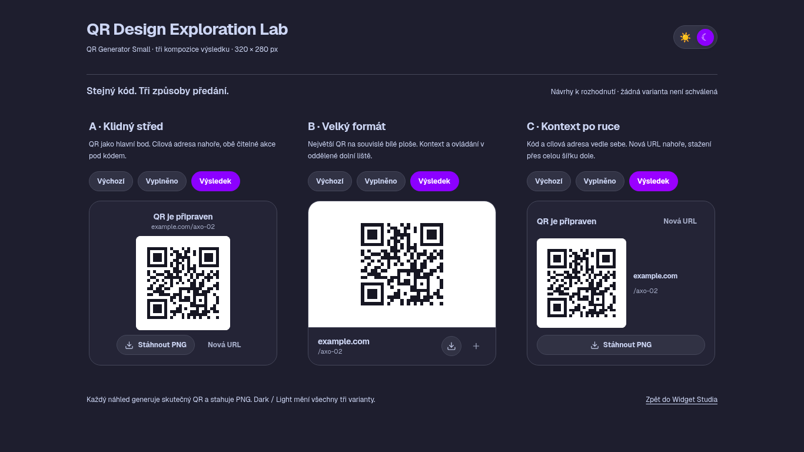
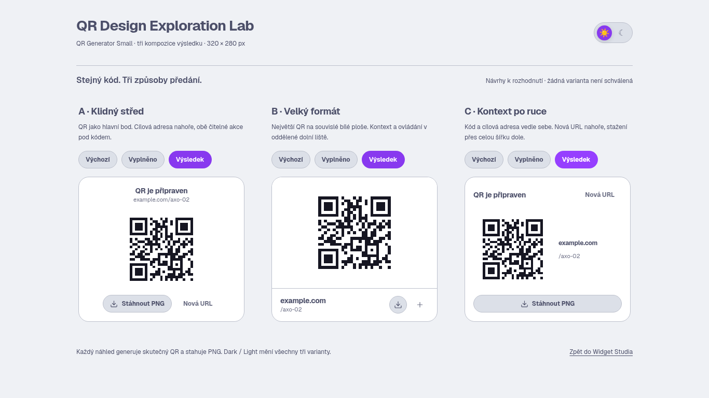

# QR Design Exploration Lab

**Stav: návrhy k rozhodnutí. Žádná varianta není schválená ani nasazená.**

Samostatný funkční lab: `labs/qr-design-exploration/index.html`. Tři skutečné kompozice QR Generator Small mají přesně **320 × 280 CSS px** a zobrazují se vedle sebe. Na úzké ploše lze porovnání vodorovně posouvat; karty se nezmenšují.

## Otevření

Z kořene repozitáře v připraveném cloudovém prostředí:

```sh
node tools/design/server.mjs
```

Otevři `/labs/qr-design-exploration/` na testovacím serveru (port 4173). Server nemá běžet současně s Playwright test runnerem, který si tento port spouští sám. Lab je samostatná stránka; nevkládá další ovládání do Widget Studia, Composition Labu ani navigace katalogu.

Každá varianta má **Výchozí / Vyplněno / Výsledek**. Při prvním otevření jsou všechny tři ve výsledném stavu. Pole lze skutečně editovat, QR generovat kliknutím nebo Enterem, stáhnout PNG a začít novou URL. Katalogový Dark/Light přepínač mění všechny tři zároveň pro stejné podmínky porovnání.

## Kompozice a doporučení

| Varianta | QR | Uspořádání | Přínos / kompromis |
| --- | --- | --- | --- |
| **A · Klidný střed** |160 ×160 px| Kontext nahoře, QR uprostřed, dvě textové akce dole | Nejvyváženější obecné řešení: QR vede, obě akce jsou srozumitelné bez hoveru. |
| **B · Velký formát** |184 ×184 px| Souvislá bílá plocha QR, kontext a ikonové akce v oddělené dolní liště | Největší prostor pro kód; ikonové akce spoléhají více na rozpoznání a tooltipy. |
| **C · Kontext po ruce** |152 ×152 px| QR vedle cílové adresy, Nová URL v horní liště, široké stažení dole | Nejlepší členění při ověřování cíle; užší sloupec adresy vyžaduje rozumné krácení. |

**Doporučení: A**, protože vyvažuje velikost kódu, ověření adresy a čitelné akce. C dává smysl, pokud je hlavní prioritou kontrola cílové adresy. B upřednostňuje maximální velikost artefaktu. Jde o doporučení, nikoli vizuální schválení nebo pokyn nahradit existující widget.

## Výsledné screenshoty

Skutečné vykreslení v Chromium se skutečným Geist; jednotlivé obrázky jsou přesně320 ×280px, společné porovnání1366 ×768px.

| Varianta | Dark | Light |
| --- | --- | --- |
| A | [Výsledek](screenshots/a-result-dark.png) | [Výsledek](screenshots/a-result-light.png) |
| B | [Výsledek](screenshots/b-result-dark.png) | [Výsledek](screenshots/b-result-light.png) |
| C | [Výsledek](screenshots/c-result-dark.png) | [Výsledek](screenshots/c-result-light.png) |

| Společné porovnání | Dark | Light |
| --- | --- | --- |
| Výchozí | [A/B/C](screenshots/comparison-empty-dark-1366x768.png) | [A/B/C](screenshots/comparison-empty-light-1366x768.png) |
| Vyplněno | [A/B/C](screenshots/comparison-filled-dark-1366x768.png) | [A/B/C](screenshots/comparison-filled-light-1366x768.png) |
| Výsledek | [A/B/C](screenshots/comparison-result-dark-1366x768.png) | [A/B/C](screenshots/comparison-result-light-1366x768.png) |





## Co se používá a co se nemění

- Barvy, tokeny, typografie a theme toggle se načítají ze skutečného kanonického `index.html`; nevznikla kopie palety nebo nový designový master.
- URL Input a tlačítka používají stávající `inputs.css`, `button.css`, `inputIcon` a `renderButton`. Není nová barevnost, gradient ani vlastní varianta tlačítka.
- `dashboardWidgetMarkup('qr', …)` a `mountQrWidget` zůstávají jediným vlastníkem QR validace, generování, PNG a resetu. Lab přeskupuje pouze svou instanci markup a konfiguruje kanonická tlačítka. Neobsahuje druhý encoder či exportní controller.
- Stávající `dashboard-widgets.css` se do Labu nenačítá. Nové kompozice mají vlastní původní pravidla v `lab.css`; nic nepřebíjí produkční definice. Žádný `!important` ani CSS opravná vrstva.
- Výsledek má v Labu viditelnou adresu a popsaný QR obraz; po generování získá focus existující tlačítko stažení. Toto chování je omezené na Lab, původní widget se neopravuje bokem.
- Původní Widget Studio, Composition Lab, všechny komponenty, index, assety a40 vizuálních referencí zůstaly beze změn. Rozšířen byl pouze lokální testovací server pro explicitní cestu Labu a testová konfigurace.

## Playwright a hranice ověření

```sh
npx --no-install playwright test qr-exploration
npm run design:test
```

- **14 nových kontrol:** A/B/C × dark/light × desktop1366 ×768/mobile390 ×844 =12 funkčních testů a2 desktopové capture testy.
- Ověření všech tří stavů,320 ×280rozměrů, HTTP(S) validace, keyboard Enter/focus, skutečného PNG/resetu a dlouhých adres uvnitř widgetu. SVG i stažené PNG čte nezávislý testovací jsQR dekodér na přesnou vstupní URL.
- Capture testy vytvářejí24 obrázků (18 jednotlivých stavů +6 porovnání). Nejsou to nově schválené regresní baseline. Existující40 baseline se dále porovnává běžnou sadou beze změn.
- **Závěrečný běh:58 prošlých testů,0 selhání,0 přeskočených.** [Review a audit](REVIEW.md) rozlišuje vizuální úsudek, mechanické nálezy a konkrétní důkazy.
- Použit skutečný Playwright 1.64.1, systémový Chromium 154.0.8037.57 a uzamčené Geist fixtures. Neověřeno: Firefox/WebKit, fyzické skenování telefonem, screen readery a plný časový průběh animací. Digitální QR dekódování není vydáváno za test fyzického zařízení.

## Všechny jednotlivé stavy

- **A**: [empty / dark](screenshots/a-empty-dark.png) · [empty / light](screenshots/a-empty-light.png) · [filled / dark](screenshots/a-filled-dark.png) · [filled / light](screenshots/a-filled-light.png) · [result / dark](screenshots/a-result-dark.png) · [result / light](screenshots/a-result-light.png)
- **B**: [empty / dark](screenshots/b-empty-dark.png) · [empty / light](screenshots/b-empty-light.png) · [filled / dark](screenshots/b-filled-dark.png) · [filled / light](screenshots/b-filled-light.png) · [result / dark](screenshots/b-result-dark.png) · [result / light](screenshots/b-result-light.png)
- **C**: [empty / dark](screenshots/c-empty-dark.png) · [empty / light](screenshots/c-empty-light.png) · [filled / dark](screenshots/c-filled-dark.png) · [filled / light](screenshots/c-filled-light.png) · [result / dark](screenshots/c-result-dark.png) · [result / light](screenshots/c-result-light.png)
